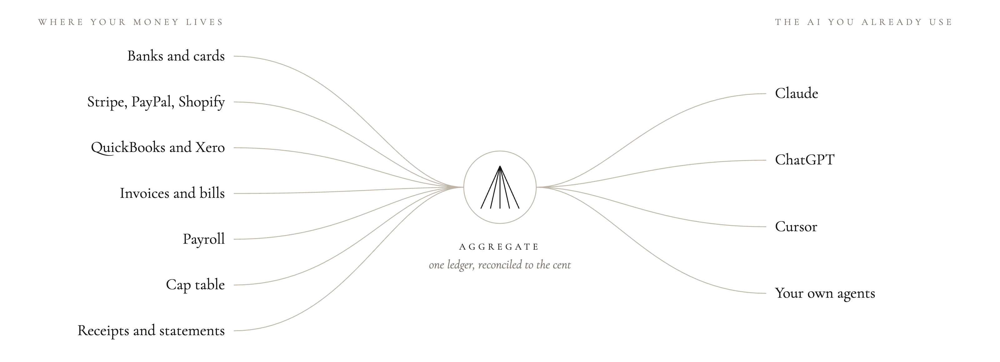

<p align="center">
  <a href="https://aggregate.finance">
    <picture>
      <source media="(prefers-color-scheme: dark)" srcset=".github/assets/logo-dark.svg">
      
    </picture>
  </a>
</p>

<h3 align="center">あなたの AI に、お金のことを聞こう。</h3>

<p align="center">
  MCP サーバーを備えた、オープンソースの複式簿記台帳。<br>
  すべての口座・会社・保有資産を、Claude、ChatGPT、または自作エージェント向けの 1 本のリンクに。<br>
  1 セント単位まで照合済み。そして AI がお金を動かすことは決してありません。
</p>

<p align="center">
  <a href="https://aggregate.finance"><b>ウェブサイト</b></a> ·
  <a href="#get-started"><b>はじめる</b></a> ·
  <a href="#run-it-yourself"><b>セルフホスト</b></a> ·
  <a href="#safety"><b>安全性</b></a> ·
  <a href="docs/connect-your-ai.md"><b>ドキュメント</b></a>
</p>

<p align="center">
  <a href="LICENSE"></a>
  <a href="#get-started"></a>
  <a href="#run-it-yourself"></a>
</p>

<p align="center"><a href="README.md">English</a> · <a href="README.zh-CN.md">简体中文</a> · <a href="README.ja.md">日本語</a> · <a href="README.ko.md">한국어</a> · <a href="README.es.md">Español</a> · <a href="README.pt-BR.md">Português (Brasil)</a> · <a href="README.de.md">Deutsch</a> · <a href="README.fr.md">Français</a></p>

> [!NOTE]
> この翻訳は英語版 README より古い場合があります。正確な内容は英語版をご覧ください。

<p align="center">
  
</p>

<table>
<tr><td><b>Aggregate は銀行のパスワードを見ますか？</b></td><td>いいえ。銀行へのログインは Plaid で、各アプリへのログインはそれぞれのページで行います。Aggregate が受け取るトークンはデータベースの外に置いた鍵で暗号化され、読み取りにしか使われません。</td></tr>
<tr><td><b>データが AI モデルの学習に使われますか？</b></td><td>いいえ。Aggregate はあなたのデータをモデルの学習に使わず、他者にも使わせません。AI が読んだ内容には、お使いの AI 提供元のポリシーが適用されます。</td></tr>
<tr><td><b>お金を動かせますか？</b></td><td>決してできません。支払い、送金、請求書の支払い、何かの送信ができるツールや接続は存在しません。</td></tr>
<tr><td><b>現金、バーン、ランウェイはどう計算しますか？</b></td><td>毎回同じ方法です。各数値は AI ではなく Aggregate が、書き出された<a href="docs/guides/definitions.md">定義</a>（英語）どおりに計算し、わからないときは推測せず「不明」と答えます。</td></tr>
<tr><td><b>まだできないことは？</b></td><td>暗号資産、米国外の銀行（代わりに明細をアップロード）、Square の現金売上などです。すべて<a href="docs/guides/limits.md">既知の制限</a>（英語）に、代わりにどうなるかとあわせて載っています。</td></tr>
</table>

<p align="center">
  <picture>
    <source media="(prefers-color-scheme: dark)" srcset=".github/assets/how-it-works-dark.png">
    
  </picture>
</p>

## こんな方に

|  |  |
|---|---|
| **創業者** | 複数の会社を並べて、それぞれがあなたにいくら借りているかも |
| **事業者** | 銀行、カード、決済、請求書、支払い、給与を 1 つの台帳に |
| **投資家** | 保有資産と、各社に持っている持分 |
| **個人** | 自分の口座、カード、現金だけを、プライベートなスペースに |

## 聞けること

つないだら、あとは聞くだけ：

> *「全社合わせて現金はいくら？ あと何か月もつ？」*
>
> *「期限切れの請求書はどれ？ 一番多く未払いなのは誰？」*
>
> *「投資の調子はどう？」*
>
> *「個人口座に今いくらある？」*
>
> *「Harbor Coffee の件で業者に現金 500 ドルを払った。記録して。」*
>
> *「各社は個人的に私にいくら借りている？」*

ほかの例は[プロンプトレシピ](docs/recipes.md)（英語）へ。考えるのは AI、Aggregate はその下の数字を正しく保ちます。支払いは 1 回だけ数え、残高は銀行と照合し、すべての記録は出どころまでたどれます。

<a id="get-started"></a>
## はじめる

|  | **ホスト版（約 2 分）** | **セルフホスト（約 10 分）** |
|---|---|---|
| **動く場所** | app.aggregate.finance | 自分のマシンやサーバー（Docker または Node） |
| **接続** | 設定済み | 自分のプロバイダーキーを使うか、明細をアップロード |
| **バックアップと更新** | おまかせ | ご自身で |
| **費用** | アーリーアクセス期間中は無料 | 無料（AGPL-3.0） |
| **開始** | [登録](https://app.aggregate.finance)して、下の手順で AI をつなぐ | [セルフホスト](#run-it-yourself) |

## AI をつなぐ

| AI | 方法 |
|---|---|
| **Claude Code** | `claude mcp add --transport http agfn https://app.aggregate.finance/mcp` |
| **Cursor, VS Code, Windsurf, Claude Code** | `npx aggregate-finance setup` (変更内容を表示するだけ。書き込むには `--yes` を追加) |
| **Claude** | 設定 → コネクタ → **カスタムコネクタを追加** → 下のリンクを貼り付け |
| **ChatGPT** | コネクタとして追加し、下のリンクを貼り付け |

または、MCP に対応した AI にこのリンクをコピー：

```
https://app.aggregate.finance/mcp
```

サインインしたら、その AI に見せる範囲を 1 文で正確に選びます。自分のサーバーなら `https://<あなたのサーバー>/mcp` を使ってください。

## つなげるもの

|  |  |
|---|---|
| **銀行とカード** | Plaid または SimpleFIN Bridge 経由であらゆる銀行・カード、さらに Mercury、Brex、Ramp、Wise と直接 |
| **決済** | Stripe, Square, Shopify, Paddle, App Store, Google Play · PayPal, Lemon Squeezy, Polar (セルフホストのみ) |
| **会計** | QuickBooks, Xero |
| **給与** | Finch、Deel、そして銀行データから見つかる Gusto 型の給与 |
| **資本政策表** | 内蔵。Carta や Pulley からの取り込みと Open Cap Table Format に対応 |
| **そのほか** | 明細（CSV、OFX、QFX、QBO）、領収書の PDF や写真、メールで届いた請求書、または AI に伝えるだけ |
| **近日対応** | BILL、Rippling、Justworks：開発済みで、実際のアカウントでテスト中 |

Aggregate は接続先からデータを読み取るだけで、お金を動かす手段は一切ありません。所有する会社が並んで管理され、さらにプライベートな**個人**スペースがあります。

> [!NOTE]
> Aggregate はまだ初期段階です。ホスト版では、Plaid、Stripe のサインイン、Shopify アプリが各プロバイダーの承認待ちです。それまでは、銀行は SimpleFIN Bridge か明細で、Shopify はご自身のアプリのキーでつなげます。その他のコネクタは各プロバイダーのドキュメントに沿って作られ、実際のアカウントで検証中です。Issue や修正を歓迎します。

<a id="safety"></a>
## 安全性

- **AI がお金を動かすことは決してありません。** 支払いも、請求書の支払いも、請求書やメールの送信もしません。決して。
- **AI ごとに個別の権限。** 読める 1 文で書かれます：どの会社、どの種類のデータ、読み取りのみか追加もできるか、いつ期限切れか。リクエストごとに毎回チェックします。
- **すべて記録され、元に戻せます。** AI の質問と追加した記録はすべて、誰が追加したかとともに記録。30 日間は取り消せ、AI の変更をあなたの確認待ちにすることもできます。どの AI もワンクリックで一時停止・取り消し。
- **秘密情報は暗号化。** プロバイダーのトークンは、データベースの外に置いた鍵で暗号化されます（KMS と 1Password に対応）。銀行ログインは Plaid を通り、Aggregate が見ることはありません。
- **プロンプトインジェクション対策。** ドキュメントやメモのテキストは信頼できないものとして扱い、変更のたびにインジェクション攻撃のレッドチームテストを実行します。
- **パスキー** （またはメールで届くコード）は、口座をつなぐときや AI の権限を広げるときに、再度必要です。

<a id="run-it-yourself"></a>
## セルフホスト

ホスト版のすべての機能を含め、すべてオープンソースです。セルフホストには Node 22.18 以上か Docker が必要です。

```sh
git clone https://github.com/Izzy-Gottz/aggregate-finance && cd aggregate-finance
(umask 077; printf 'AUTH_SECRET=%s\nAGFN_MASTER_KEY=%s\n' "$(openssl rand -hex 32)" "$(openssl rand -base64 32)" > .env)
docker compose up -d         # http://localhost:8787
```

**`.env` はこのマシンの外の安全な場所にコピーしてください。** その中の `AGFN_MASTER_KEY` が保存された銀行トークンとバックアップを暗号化します。なくすと、どちらも読めなくなります。 詳しいガイド： [セルフホスト（英語）](docs/self-hosting.md).

40 個のツールすべてと詳細は[英語版 README](README.md) にあります。

## ライセンス

[AGPL-3.0-only](LICENSE)。無料で使用、変更、セルフホストできます。変更したバージョンを他者向けのサービスとして運用する場合は、同じライセンスで変更を公開してください。
