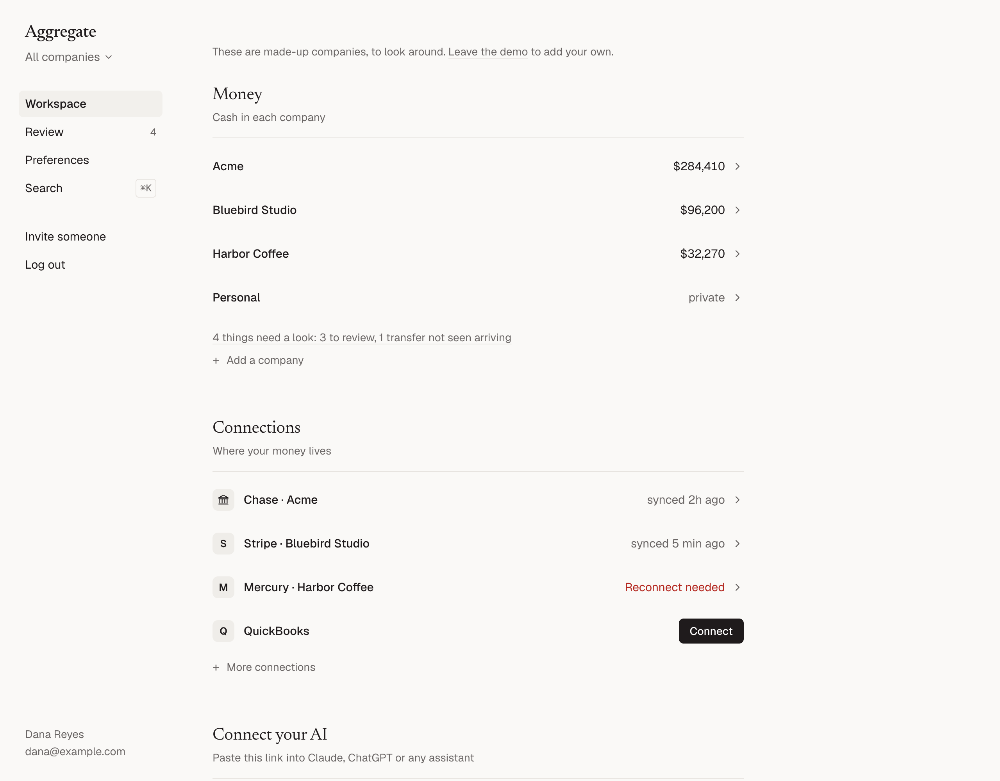
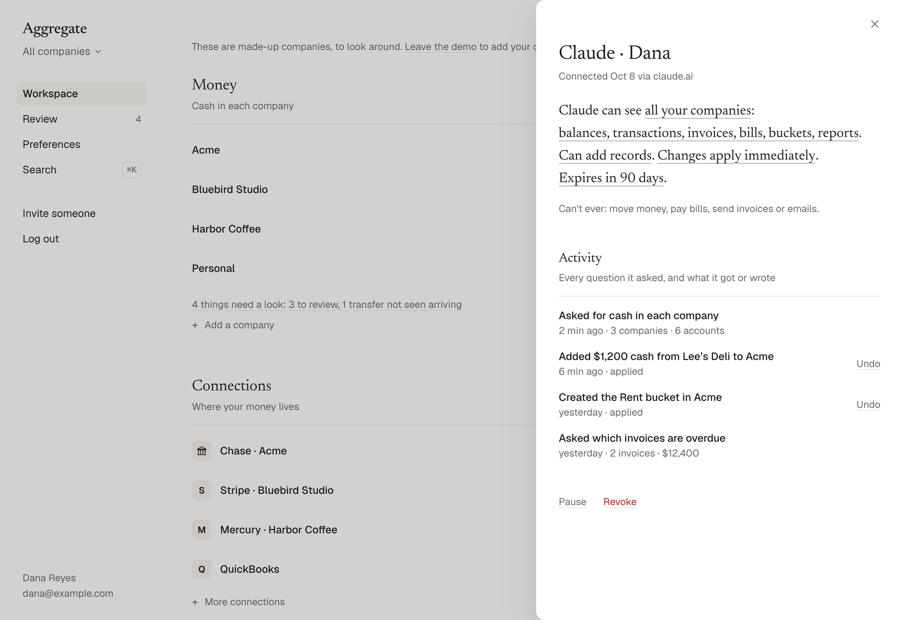

<p align="center">
  <a href="https://aggregate.finance">
    <picture>
      <source media="(prefers-color-scheme: dark)" srcset=".github/assets/logo-dark.svg">
      
    </picture>
  </a>
</p>

<h3 align="center">Ask your AI about your finances.</h3>

<p align="center">
  Aggregate is a read-only finance MCP server: an open-source double-entry ledger that connects your banks, cards, payment apps, books and payroll to your AI.<br>
  Every account, company and holding, in one link for Claude, ChatGPT or your own agents.<br>
  Reconciled to the cent, and your AI can never move money.
</p>

<p align="center">
  <a href="https://aggregate.finance"><b>Website</b></a> ·
  <a href="#get-started"><b>Get started</b></a> ·
  <a href="#run-it-yourself"><b>Self-host</b></a> ·
  <a href="#safety"><b>Safety</b></a> ·
  <a href="docs/connect-your-ai.md"><b>Docs</b></a>
</p>

<p align="center">
  <a href="LICENSE"></a>
  <a href="#get-started"></a>
  <a href="#run-it-yourself"></a>
  <a href="https://scorecard.dev/viewer/?uri=github.com/Izzy-Gottz/aggregate-finance"></a>
  <a href="https://skills.sh/Izzy-Gottz/aggregate-finance"></a>
</p>

<p align="center"><a href="README.md">English</a> · <a href="README.zh-CN.md">简体中文</a> · <a href="README.ja.md">日本語</a> · <a href="README.ko.md">한국어</a> · <a href="README.es.md">Español</a> · <a href="README.pt-BR.md">Português (Brasil)</a> · <a href="README.de.md">Deutsch</a> · <a href="README.fr.md">Français</a></p>

<br>

<p align="center">
  
</p>

<table>
<tr><td><b>Does Aggregate see my bank password?</b></td><td>No. You sign in to your bank through Plaid, and to each app on its own page. Aggregate gets a token, encrypted with a key kept outside the database, and only ever uses it to read.</td></tr>
<tr><td><b>Does my data train AI models?</b></td><td>No. Aggregate never uses your data to train models and doesn’t let anyone else. What your AI reads is covered by your AI provider’s own policy.</td></tr>
<tr><td><b>Can it move money?</b></td><td>Never. There’s no tool and no connection that can pay, transfer or pay a bill. It emails someone else only when you send an invite.</td></tr>
<tr><td><b>How does it count cash, burn and runway?</b></td><td>The same way every time. Aggregate computes each figure from one written <a href="docs/guides/definitions.md">definition</a>, not your AI, and says “unknown” instead of guessing.</td></tr>
<tr><td><b>What doesn’t it do yet?</b></td><td>Crypto, banks outside the US (upload statements instead), cash sales in Square, and more. Each is on <a href="docs/guides/limits.md">Known limits</a>, with what happens instead.</td></tr>
</table>

<p align="center">
  <picture>
    <source media="(prefers-color-scheme: dark)" srcset=".github/assets/how-it-works-dark.png">
    
  </picture>
</p>

<br>

## Who it’s for

|  |  |
|---|---|
| **Founders** | Several companies side by side, and what each one owes you |
| **Businesses** | Banks, cards, payments, invoices, bills and payroll in one ledger |
| **Investors** | Your holdings, and the stakes you hold in companies |
| **Individuals** | Just your own accounts, cards and cash, in a private space |

## What you can ask

Once it’s connected, just ask:

> *“How much cash do we have across all our companies, and how many months of runway?”*
>
> *“Which invoices are overdue, and who owes us the most?”*
>
> *“How are my investments doing?”*
>
> *“How much is in my personal accounts right now?”*
>
> *“I paid a contractor $500 in cash for Harbor Coffee. Add it.”*
>
> *“What does each company owe me personally?”*

More in the [prompt recipes](docs/recipes.md).

Your AI does the thinking. Aggregate makes sure the numbers underneath are right: every payment counted once,
balances checked against your bank, and every record traceable to where it came from.

<p align="center">
  <picture>
    <source media="(prefers-color-scheme: dark)" srcset=".github/assets/screen-workspace-dark.png">
    
  </picture>
</p>

## Get started

|  | **Hosted** (about 2 minutes) | **Self-host** (about 10 minutes) |
|---|---|---|
| **Where it runs** | app.aggregate.finance | Your machine or server, with Docker or Node |
| **Connections** | Set up for you | Bring your own provider keys, or upload statements |
| **Backups and updates** | Done for you | Yours |
| **Cost** | Free during early access | Free (AGPL-3.0) |
| **Start** | [Sign up](https://app.aggregate.finance), then connect your AI below | [Run it yourself](#run-it-yourself) |

## Connect your AI

One line for each AI:

| AI | How |
|---|---|
| **Claude Code** | `claude mcp add --transport http agfn https://app.aggregate.finance/mcp` |
| **Cursor, VS Code, Windsurf, Claude Code** | `npx aggregate-finance setup` (shows what it would change; add `--yes` to write it) |
| **Cursor** | One click: <a href="https://cursor.com/en/install-mcp?name=aggregate&config=eyJ1cmwiOiJodHRwczovL2FwcC5hZ2dyZWdhdGUuZmluYW5jZS9tY3AifQ=="></a> |
| **Claude** | Settings → Connectors → **Add custom connector** → paste the link below |
| **ChatGPT** | Add it as a connector and paste the link below |

Or copy the link into any AI that supports MCP:

```
https://app.aggregate.finance/mcp
```

You sign in, then choose exactly what that AI can see in one plain sentence. Running your own server? Use
`https://<your-server>/mcp` instead.

**Agent skill.** Teach your agent when to use these tools, the fixed definitions behind cash, burn and runway, and to
stay read-only unless you ask ([`skills/aggregate/SKILL.md`](skills/aggregate/SKILL.md)):

```sh
npx skills add Izzy-Gottz/aggregate-finance
```

<details>
<summary><b>Bots and scripts that can’t sign in</b></summary>
<br>

Create a key in **Connect your AI → Connect another AI → A bot or script**. Keys look like `agfn_live_…`, are shown
once and always expire. Send it as a header:

```sh
curl -H "Authorization: Bearer $AGFN_KEY" https://app.aggregate.finance/v1/overview
```

Or bridge it to a local MCP client over stdio:

```sh
AGFN_KEY=agfn_live_… npx aggregate-finance mcp --url https://app.aggregate.finance/mcp
```

The same tools are available as a REST API, described at [`/v1/openapi.json`](https://app.aggregate.finance/v1/openapi.json).

</details>

## What it connects

|  |  |
|---|---|
| **Banks and cards** | Any bank or card through Plaid or SimpleFIN Bridge, plus Mercury, Brex, Ramp and Wise directly |
| **Payments** | Stripe (multiple accounts), Square, Shopify, Paddle, App Store, Google Play · PayPal, Lemon Squeezy and Polar when you self-host (coming soon on hosted) |
| **Accounting** | QuickBooks, Xero, BILL (bills and payables) |
| **Payroll** | Deel, and payroll from Gusto, Justworks and others spotted in your bank data |
| **Cap table** | Built in. Imports Pulley’s cap-table export (Pulley shuts down Dec 8, 2026; the import stays for teams moving off it), Carta and Mantle OCX (.xlsx), CSV ledgers and Open Cap Table Format |
| **Investments** | Wefunder portfolios (for investors) |
| **Everything else** | Statements (CSV, OFX, QFX, QBO), PDFs and photos of receipts, bills sent by email, or just tell your AI |
| **Coming soon** | Finch and Rippling: built, and being tested with real accounts |

Aggregate only ever reads from your providers and has no way to move money. On hosted, Stripe and Square access is
read-only at the source too. QuickBooks, BILL, Lemon Squeezy and Expensify don't offer read-only access, so what they
grant could do more than read; Aggregate only reads from all four. Every company you own lives side by side, plus a private **Personal** space.

> [!NOTE]
> Aggregate is early. On hosted, Stripe has been on the Stripe App Marketplace since 2026-10-26 and Shopify on the
> Shopify App Store since 2026-10-22. Xero connects up to 5 organizations on hosted until Xero certifies
> the app. The other
> connectors are built to each provider’s documentation and are being verified with real accounts. Issues and fixes
> are very welcome.

## How it compares

|  | **Aggregate** | One provider’s own MCP server | Personal finance app with AI |
|---|---|---|---|
| Several sources in one place (banks, payments, accounting, payroll, cap table) | ✓ | One provider | Banks and cards |
| Several companies side by side, plus personal | ✓ | One account | Personal |
| One double-entry ledger, transfers and payouts counted once | ✓ | — | Varies |
| Works with any AI that speaks MCP | ✓ | ✓ | Usually their own AI |
| Open source, self-hostable | ✓ (AGPL-3.0) | Varies | Rarely |
| Can move money | Never | Some can | Varies |

We also measured it. On [our benchmark](docs/benchmark/results.md) (100 questions about one made-up company, one
model), answers through Aggregate were 100/100 correct. The same model reading tidy exported files with Python got
98/100 and cost less ($0.17 against $0.41). Read the caveats there before quoting it: a two-question gap is within
run-to-run noise, Aggregate's tools were tuned on these same questions, and real exports are messier than the ones
tested.

## Safety

Money is the one place an AI can’t be sloppy, so control is the core of the product, not an add-on.

<p align="center">
  <picture>
    <source media="(prefers-color-scheme: dark)" srcset=".github/assets/screen-ai-dark.png">
    
  </picture>
</p>

- **Your AI can never move money.** No payments, no bills paid, no invoices or emails sent. Ever.
- **Each AI gets its own permission**, written as a sentence you can read: which companies, which kinds of data,
  read only or read and add, and when it expires. Checked on every single request.
- **Everything is logged and undoable.** Every question an AI asks and every record it adds, labeled with who added it.
  Undo for 30 days, or turn on review so AI changes wait for you. Pause or revoke any AI in one click.
- **Your secrets stay encrypted.** Provider tokens are encrypted with a key kept outside the database (KMS and
  1Password supported). Bank logins go through Plaid and are never seen by Aggregate.
- **Built for prompt injection.** Text from documents and memos is treated as untrusted, and a red-team suite of
  injection attacks runs on every change.
- **Passkeys** (or a code sent by email) are required again before connecting accounts or giving an AI more access.

Read the [threat model](docs/security/threat-model.md) and [security policy](SECURITY.md).

## Run it yourself

Everything is open source, including every hosted feature. Self-hosting needs Node 22.18+ or Docker.

```sh
git clone https://github.com/Izzy-Gottz/aggregate-finance && cd aggregate-finance
(umask 077; printf 'AUTH_SECRET=%s\nAGFN_MASTER_KEY=%s\n' "$(openssl rand -hex 32)" "$(openssl rand -base64 32)" > .env)
docker compose up -d         # http://localhost:8787
```

<details>
<summary><b>Without Docker</b></summary>
<br>

```sh
npm install
npm run -s keygen > .env     # -s keeps npm's own output out of the file
npm run build -w @agfn/web
npm start                    # http://localhost:8787
```

</details>

**Copy `.env` somewhere safe, off this machine.** Its `AGFN_MASTER_KEY` encrypts your stored bank tokens and your
backups; without it neither can be read. Without email set up, sign-in links print to the server console
(`docker compose logs agfn`). Each connector turns on when its keys are in `.env`
(see [.env.example](.env.example)). Postgres or SQLite, Fly.io and Railway configs included. Full guide:
[self-hosting](docs/self-hosting.md).

Prefer not to run servers? [Hosted Aggregate](https://aggregate.finance) is the same code, with banking connections,
backups and updates handled for you.

<details>
<summary><b>All 40 tools your AI gets</b></summary>
<br>

**Read**

| Tool | What it does |
|---|---|
| `get_overview` | Cash and key numbers for every company |
| `list_accounts` | Accounts and balances |
| `search_transactions` | Search transactions |
| `query_transactions` | Add up transactions by month, category, vendor, company and more |
| `search_invoices` | Search invoices and bills |
| `query_invoices` | Add up invoices and bills, including how overdue they are |
| `get_reports` | Profit and loss, balance sheet, cash flow |
| `get_metric` | One defined metric, with how it was worked out |
| `get_mrr_movements` | Recurring revenue by month: new, expansion, churn |
| `list_upcoming` | Money expected in and out |
| `list_recurring` | Subscriptions and recurring bills, with price changes |
| `get_liabilities` | Credit cards and loans: rates, minimums, due dates |
| `get_holdings` | Investment positions and their value |
| `get_owner_balance` | What each company owes you, or you owe it |
| `get_counterparty` | One customer or vendor |
| `get_cap_table` | Cap table |
| `get_payroll` | Payroll |
| `list_buckets`, `get_bucket` | Money set aside, like rent or taxes |
| `list_documents`, `get_document` | Receipts, bills and statements |
| `get_coverage` | Which months of each account are complete, missing or off |
| `list_review_items` | Things waiting for a look |
| `get_activity` | Who did what, and when |
| `get_record` | Any record by id |
| `whoami` | What this AI is allowed to see |
| `refresh_balance` | Ask the bank for balances right now |

**Add** (only with permission to add)

| Tool | What it does |
|---|---|
| `add_entry` | Cash, an expense, owner money or a transfer |
| `add_invoice` | An invoice or bill |
| `record_payment` | Apply a payment to invoices or bills |
| `pin_balance` | A balance from a statement, checked against the records |
| `create_bucket`, `update_bucket` | Set money aside |
| `create_rule` | Teach it how to handle something next time |
| `update_record`, `void_record` | Fix or void a record |
| `record_equity_event` | Shares, options, SAFEs and rounds |
| `resolve_review_item` | Settle something waiting for review |
| `close_period`, `reopen_period` | Close the books through a date, or reopen them |

</details>

<details>
<summary><b>How the code is organized</b></summary>
<br>

| Path | What |
|---|---|
| `apps/server` | HTTP server: sign-in, OAuth for AI clients, connectors, documents, MCP, web app |
| `apps/web` | The interface (Preact) |
| `packages/core` | Double-entry ledger, matching, rules, buckets, metrics, reports |
| `packages/mcp` | MCP server and REST API: tools, permissions, write pipeline, activity log |
| `packages/connectors/*` | One package per provider, plus the SDK and registry |
| `packages/invoices` | Invoices, bills, payments, payroll |
| `packages/equity` | Cap table and rounds |
| `packages/cli` | The `agfn` command line |
| `packages/auth`, `db`, `security`, `sync`, `files`, `contracts` | Foundation |

</details>

If Aggregate is useful to you, a star helps other people find it.

## Contributing

Bug reports, new connectors and fixes are welcome. Start with [CONTRIBUTING.md](CONTRIBUTING.md). Security issues go to
[SECURITY.md](SECURITY.md), never public issues.

## License

[AGPL-3.0-only](LICENSE) (GNU Affero General Public License v3.0 only; no additional terms). Free to use, change and self-host. If you run a modified version as a service for others,
share your changes under the same license.
